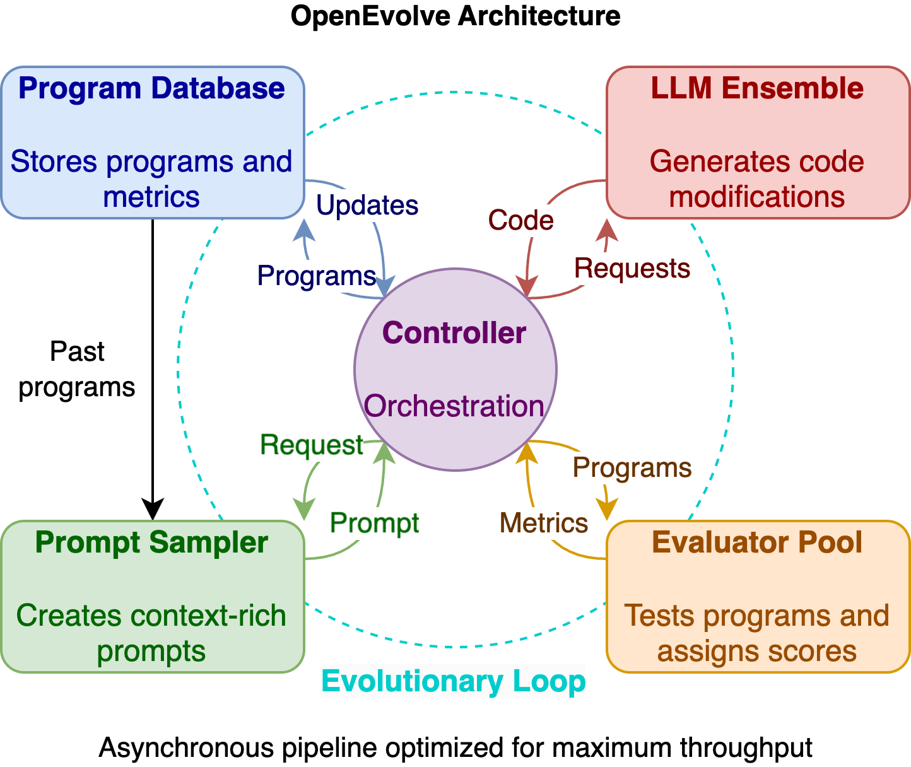

# OpenEvolve

<div align="center">


**The most advanced open-source evolutionary coding agent**

*Turn your LLMs into autonomous code optimizers that discover breakthrough algorithms*

<p align="center">
  <a href="https://pypi.org/project/openevolve/"></a>
  <a href="https://pepy.tech/projects/openevolve"></a>
  <a href="https://github.com/algorithmicsuperintelligence/openevolve/blob/main/LICENSE"></a>
</p>

[Quick Start](#quick-start) • [Used In Research](#used-in-research) • [Examples](#examples) • [Docs](#documentation) • [Discussions](https://github.com/algorithmicsuperintelligence/openevolve/discussions)

</div>

---

OpenEvolve is an open-source implementation of Google DeepMind's AlphaEvolve. It uses LLMs to mutate programs and evolves them with MAP-Elites and island populations, so you can point it at any problem you can score. It has become a standard tool and baseline for LLM-driven algorithm discovery: **cited in hundreds of research papers**, with 7,600+ GitHub stars, 1,200+ forks, 80+ contributors and 17,000+ monthly PyPI downloads.

## Used In Research

**Producing new results**

| Paper | How OpenEvolve is used |
|-------|------------------------|
| [New Bounds for Zarankiewicz Numbers via Reinforced LLM Evolutionary Search](https://arxiv.org/abs/2605.01120) | New bounds in extremal combinatorics, obtained with OpenEvolve |
| [Let the Barbarians In: How AI Can Accelerate Systems Performance Research](https://arxiv.org/abs/2512.14806) | Ten systems performance case studies, using OpenEvolve among other tools |
| [Algorithmic Algorithm Development with LLMs](https://arxiv.org/abs/2606.01975) | Contraction order optimization for tensor networks |
| [Even with AI, Bijection Discovery is Still Hard](https://arxiv.org/abs/2511.20987) | Combinatorial bijection discovery |

**Security research**

| Paper | How OpenEvolve is used |
|-------|------------------------|
| [Trojan Hippo Bench](https://arxiv.org/abs/2605.01970) | Adaptive red-teaming benchmark for persistent memory attacks on LLM agents |
| [Divide and Inject](https://arxiv.org/abs/2609.36576) | Refining indirect prompt injection fragments |
| [LLM-Guided Prompt Evolution for Password Guessing](https://arxiv.org/abs/2604.12601) | Evolving prompts that maximize cracking rate |
| [Targeted Black-Box Attacks on Perceptual Hash Algorithms](https://arxiv.org/abs/2607.11472) | Evolutionary attack framework based on GigaEvo and OpenEvolve |

**Building on OpenEvolve**

| Paper | Relationship |
|-------|--------------|
| [Hill Sampling for Test-Time Scaling](https://arxiv.org/abs/2609.25510) | Builds on OpenEvolve's problems and evaluators |
| [CodeEvolve: Runtime-Enriched Target Selection](https://arxiv.org/abs/2605.04677) | Extends OpenEvolve for Java and Salesforce Apex |
| [GraphIR](https://arxiv.org/abs/2608.01633) | Neural architecture search states integrated into OpenEvolve |
| [SwarmEvolve: Latent Agent Swarms for Evolutionary Discovery and Optimization](https://arxiv.org/abs/2611.08483) · [Code](https://github.com/Qile-J/SwarmEvolve) | Uses OpenEvolve's problems and evaluators for 16 AlphaEvolve problems, and benchmarks against OpenEvolve |

New evolutionary agents also routinely benchmark against OpenEvolve, including [HarnessTTT](https://arxiv.org/abs/2610.17370), [FrugalEvo](https://arxiv.org/abs/2610.03675), [SEDIMA](https://arxiv.org/abs/2610.02361), [EvoDuet](https://arxiv.org/abs/2609.40340), [LoongFlow](https://arxiv.org/abs/2512.24077) and [AscendOptimizer](https://arxiv.org/abs/2603.23566).

Using OpenEvolve in your work? Open a pull request to add it here, and see [Citation](#citation).

## Results

| Domain | Achievement | Example |
|--------|-------------|---------|
| GPU optimization | Hardware-optimized kernel discovery, with 2-3x speedups on real hardware | [MLX Metal Kernels](examples/mlx_metal_kernel_opt/) |
| Mathematics | State-of-the-art circle packing (n=26) | [Circle Packing](examples/circle_packing/) |
| Algorithm design | Adaptive sorting algorithms | [Rust Adaptive Sort](examples/rust_adaptive_sort/) |
| Scientific computing | Automated filter design | [Signal Processing](examples/signal_processing/) |
| Multi-language | Python, Rust, R, Metal shaders | [All Examples](examples/) |

| Generation 1 | Generation 190 | Generation 460 (final) |
|--------------|----------------|------------------------|
|  |  |  |
| Random placement | Learning structure | State-of-the-art result |

**Compared with manual optimization:**

| Aspect | Manual Optimization | OpenEvolve |
|--------|---------------------|------------|
| Time to solution | Days to weeks | Hours |
| Exploration breadth | Limited by human creativity | Unlimited LLM creativity |
| Reproducibility | Hard to replicate | Fully deterministic |
| Multi-objective | Complex tradeoffs | Automatic Pareto optimization |
| Scaling | Doesn't scale | Parallel evolution across islands |

## Quick Start

Requires Python 3.10+ and access to an LLM.

```bash
git clone https://github.com/algorithmicsuperintelligence/openevolve.git
cd openevolve
pip install -e .

# The example uses Google Gemini by default (free tier available)
# Get your API key from: https://aistudio.google.com/apikey
export OPENAI_API_KEY="your-gemini-api-key"  # Yes, use OPENAI_API_KEY

python openevolve-run.py examples/function_minimization/initial_program.py \
  examples/function_minimization/evaluator.py \
  --config examples/function_minimization/config.yaml \
  --iterations 50
```

To use another provider, change `api_base` and the model in `config.yaml`. See [LLM Providers](docs/llm-providers.md).

Or use it as a library (`pip install openevolve`):

```python
from openevolve import evolve_function

def bubble_sort(arr):
    for i in range(len(arr)):
        for j in range(len(arr) - 1):
            if arr[j] > arr[j + 1]:
                arr[j], arr[j + 1] = arr[j + 1], arr[j]
    return arr

if __name__ == "__main__":
    result = evolve_function(
        bubble_sort,
        test_cases=[([3, 1, 2], [1, 2, 3]), ([5, 2, 8], [2, 5, 8])],
        iterations=50,
    )
    print(result.best_code)
```

`run_evolution` also takes inline code and an evaluator function. The `__main__` guard is required on macOS and Windows, where multiprocessing uses `spawn`.

A Docker image is available too:

```bash
docker pull ghcr.io/algorithmicsuperintelligence/openevolve:latest

docker run --rm -v $(pwd):/app ghcr.io/algorithmicsuperintelligence/openevolve:latest \
  examples/function_minimization/initial_program.py \
  examples/function_minimization/evaluator.py --iterations 100
```

## How It Works



- **Quality-diversity evolution:** MAP-Elites keeps diverse programs across feature dimensions.
- **Island populations:** separate populations with periodic migration prevent premature convergence.
- **LLM ensembles:** weighted combinations of models, from any OpenAI-compatible API or the Claude Code, GitHub Copilot and Codex CLIs.
- **Artifact feedback:** errors and evaluator output feed the next generation's prompt.
- **Reproducibility:** every component is seeded.

Mark the code to evolve with `EVOLVE-BLOCK-START` and `EVOLVE-BLOCK-END` comments. More in [How It Works](docs/how-it-works.md).

Good fits are performance optimization, algorithm discovery, scientific computing, competitive programming and multi-objective problems.

## Examples

| Project | Domain | What it evolves |
|---------|--------|-----------------|
| [Function Minimization](examples/function_minimization/) | Optimization | Random search to simulated annealing |
| [Circle Packing](examples/circle_packing/) | Mathematics | The n=26 AlphaEvolve task |
| [AlphaEvolve Math Problems](examples/alphaevolve_math_problems/) | Mathematics | Problems from AlphaEvolve's appendices |
| [MLX GPU Kernels](examples/mlx_metal_kernel_opt/) | Hardware | Apple Silicon Metal kernels |
| [Rust Adaptive Sort](examples/rust_adaptive_sort/) | Algorithms | Data-aware sorting |
| [Symbolic Regression](examples/symbolic_regression/) | Science | Equation discovery on LLM-SRBench |
| [Prompt Optimization](examples/llm_prompt_optimization/) | LLMs | Prompts instead of code |
| [Online Judge](examples/online_judge_programming/) | Programming | Competitive programming solutions |
| [Web Scraper + OptiLLM](examples/web_scraper_optillm/) | AI integration | Test-time compute |

Running Google's AlphaEvolve examples? See the [interoperability walkthrough](examples/alphaevolve_interop/).

## Documentation

- [How It Works](docs/how-it-works.md): the evolution pipeline and its features
- [LLM Providers](docs/llm-providers.md): provider setup and cost
- [Configuration](docs/configuration.md): options, evaluator arguments, prompt templates, island and population strategies, artifacts, and the visualizer
- [System Messages](docs/system-messages.md): the guidance that matters most for good results
- [Showcase](docs/showcase.md): worked before-and-after examples
- [FAQ](docs/faq.md) and [Roadmap](docs/roadmap.md)

Articles:

- [Towards Open Evolutionary Agents](https://huggingface.co/blog/driaforall/towards-open-evolutionary-agents)
- [OpenEvolve: GPU Kernel Discovery](https://huggingface.co/blog/codelion/openevolve-gpu-kernel-discovery)
- [OpenEvolve: Evolutionary Coding with LLMs](https://huggingface.co/blog/codelion/openevolve)

## Contributing

Contributions are welcome. See the [Contributing Guide](CONTRIBUTING.md) and [`good first issue`](https://github.com/algorithmicsuperintelligence/openevolve/issues?q=is%3Aissue+is%3Aopen+label%3A%22good+first+issue%22) labels.

<a href="https://github.com/algorithmicsuperintelligence/openevolve/graphs/contributors">
  
</a>

## Citation

If you use OpenEvolve in your research, please cite:

```bibtex
@software{openevolve,
  title = {OpenEvolve: an open-source evolutionary coding agent},
  author = {Asankhaya Sharma},
  year = {2025},
  publisher = {GitHub},
  url = {https://github.com/algorithmicsuperintelligence/openevolve}
}
```
