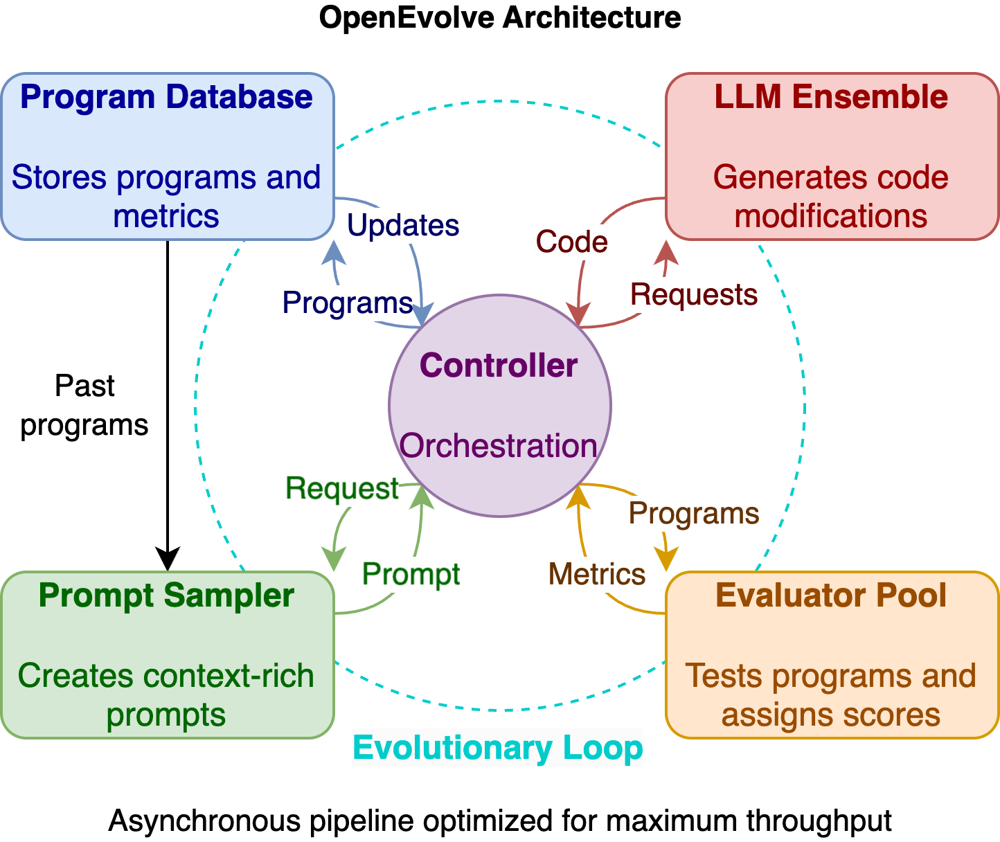

# How OpenEvolve Works

OpenEvolve implements a sophisticated **evolutionary coding pipeline** that goes far beyond simple optimization:

### **Core Innovation**: MAP-Elites + LLMs

- **Quality-Diversity Evolution**: Maintains diverse populations across feature dimensions
- **Island-Based Architecture**: Multiple populations prevent premature convergence
- **LLM Ensemble**: Multiple models with intelligent fallback strategies
- **Artifact Side-Channel**: Error feedback improves subsequent generations

## Features

### Scientific Reproducibility

- **Comprehensive Seeding**: Every component (LLM, database, evaluation) is seeded
- **Default Seed=42**: Immediate reproducible results out of the box
- **Deterministic Evolution**: Exact reproduction of runs across machines
- **Component Isolation**: Hash-based isolation prevents cross-contamination

### Advanced LLM Integration

- **Universal API**: Works with OpenAI, Google, Claude Code CLI, local models, and proxies
- **Intelligent Ensembles**: Weighted combinations with sophisticated fallback
- **Test-Time Compute**: Enhanced reasoning through proxy systems (see [OptiLLM setup](llm-providers.md))
- **Plugin Ecosystem**: Support for advanced reasoning plugins

### Evolution Algorithm Innovations

- **Double Selection**: Different programs for performance vs inspiration
- **Adaptive Feature Dimensions**: Custom quality-diversity metrics
- **Migration Patterns**: Ring topology with controlled gene flow
- **Multi-Strategy Sampling**: Elite, diverse, and exploratory selection
